<h1 align="center">Johnny</h1>

<p align="center">
  <strong>Your own S3. One command to install, a clean panel to run it, nothing to rent.</strong>
</p>

<p align="center">
  Self-hosted, S3-compatible object storage for a single VPS: <a href="https://garagehq.deuxfleurs.fr/">Garage</a> underneath,<br>
  HTTPS, nightly backups, self-updates, a JSON API and a web panel on top.
</p>

<p align="center">
  <a href="https://johnny.web.ap.it"><strong>Website</strong></a> ·
  <a href="#quick-start-autoinstall"><strong>Install</strong></a> ·
  <a href="#web-panel"><strong>Panel</strong></a> ·
  <a href="#panel-api"><strong>API</strong></a> ·
  <a href="#local-demo"><strong>Local demo</strong></a> ·
  <a href="VERSION">Version</a> ·
  <a href="LICENSE">MIT</a>
</p>

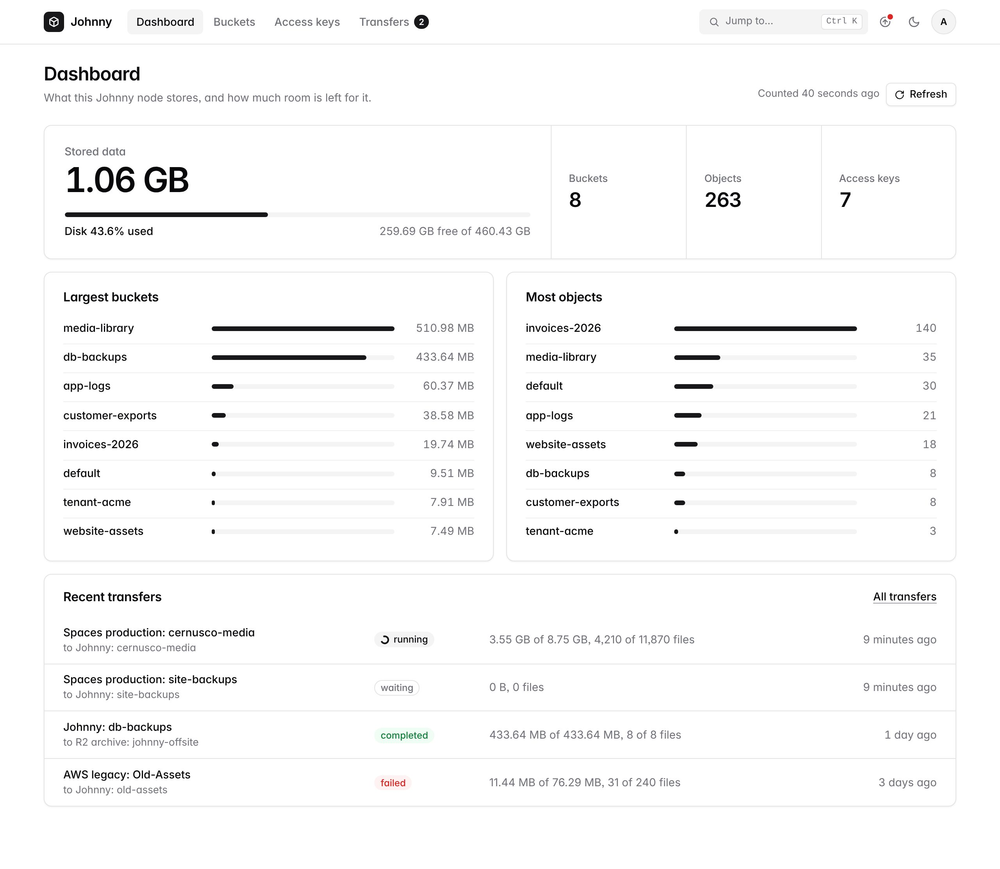

```bash
git clone https://github.com/andreapollastri/johnny.git /opt/johnny
sudo bash /opt/johnny/scripts/autoinstall.sh
```

Point any S3 client at it — the AWS CLI and SDKs, Laravel's `s3` disk, rclone, boto3 — and manage the rest from the browser.

## Why Johnny

- **It is just S3.** Garage speaks the S3 API, so the tools you already use keep working. No lock-in, no per-GB bill.
- **It looks after itself.** TLS certificates, nightly SFTP backups with retention, nightly updates of Johnny and of the server, automatic rollback when an update does not answer.
- **A panel you will actually open.** Browse and preview files, share a link, set quotas and expiry rules, hand out scoped keys, watch a transfer run.
- **Data moves in and out.** Import buckets from AWS S3, R2, Spaces, B2 and any S3 provider, export to them or to an SFTP server, or keep the two in sync every minute.
- **Everything is scriptable.** A `johnny` CLI on the server and a JSON API with one-call tenant provisioning.

<table>
  <tr>
    <td width="50%">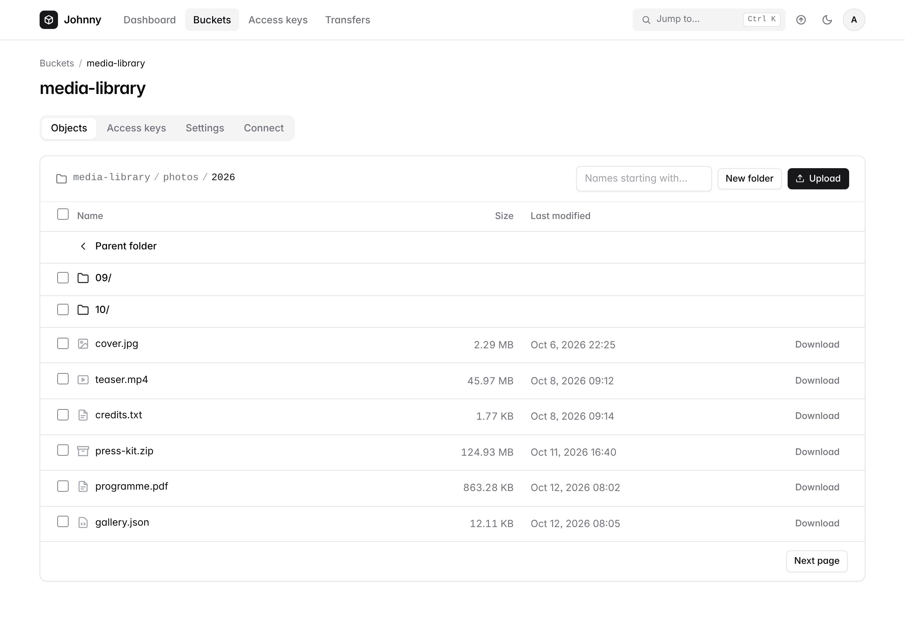<br><sub><b>File browser</b> — folders, drag and drop, resumable uploads, bulk actions</sub></td>
    <td width="50%">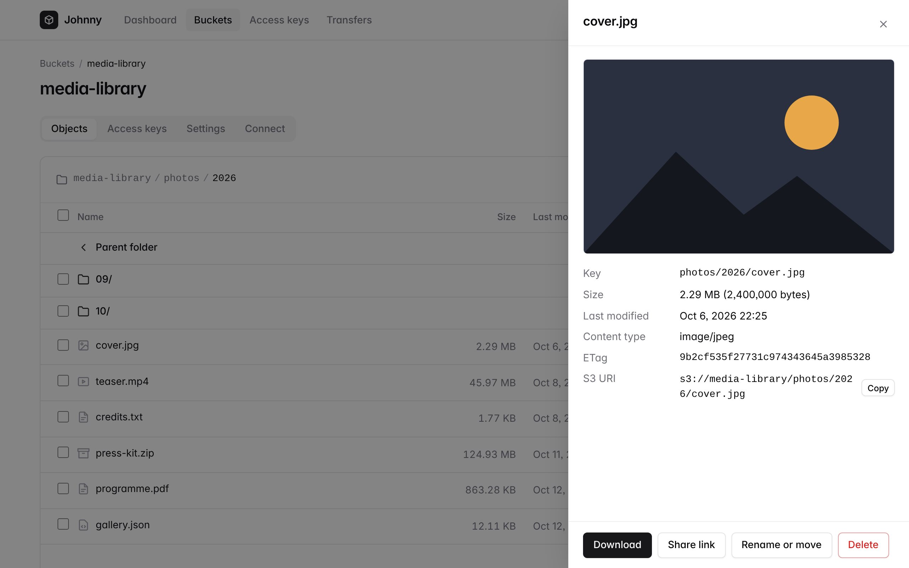<br><sub><b>Preview and share</b> — images, video, audio, PDF, text; links that expire</sub></td>
  </tr>
  <tr>
    <td>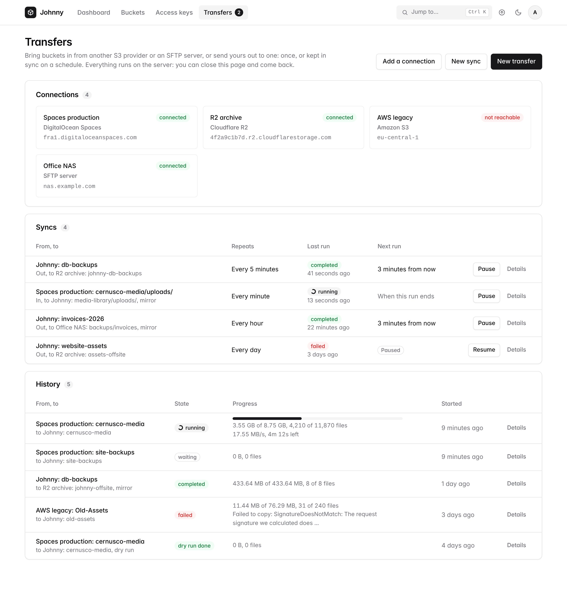<br><sub><b>Transfers</b> — import, export and scheduled syncs with other providers</sub></td>
    <td>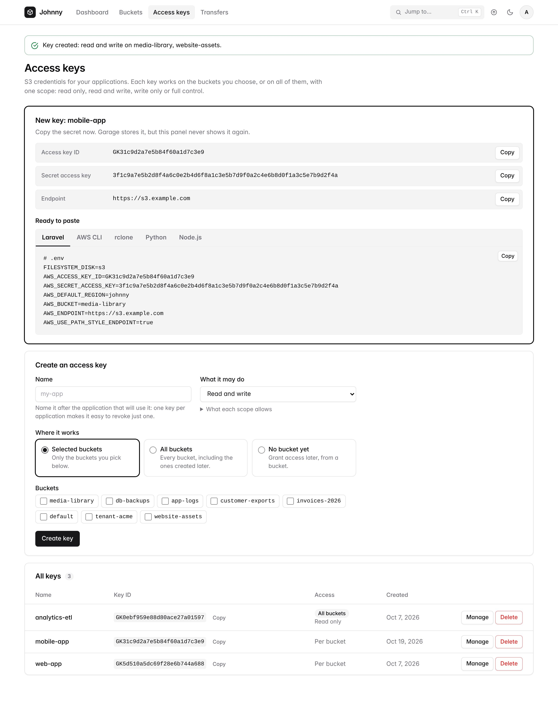<br><sub><b>Access keys</b> — per bucket or for all buckets, each with one scope</sub></td>
  </tr>
  <tr>
    <td>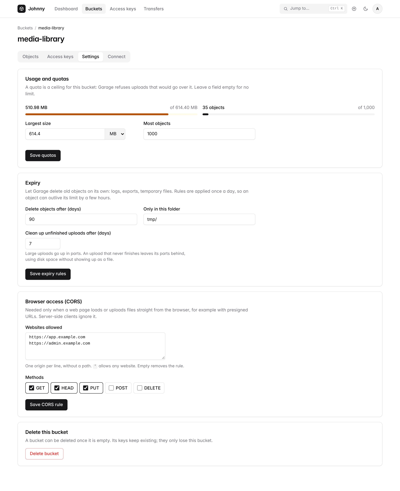<br><sub><b>Bucket settings</b> — quotas, expiry rules, CORS</sub></td>
    <td>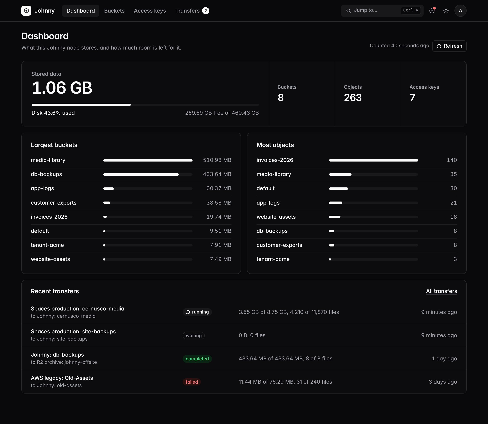<br><sub><b>Dark mode</b> — follows the system, or the toggle in the bar</sub></td>
  </tr>
</table>

<sub>Screenshots show the 2.0 panel with sample data. `node demo/screenshots.mjs` takes them again from the [local demo](#local-demo), a real Garage node.</sub>

---

## Key Features

| | |
|---|---|
| **S3-compatible storage** | Powered by Garage — use any AWS SDK, `aws` CLI, or S3 client |
| **One-command install** | Single script sets up Garage, Caddy (Let's Encrypt TLS), rclone, cron |
| **Automated SFTP backups** | Nightly sync of every bucket to one or more remote servers, with configurable retention |
| **Web panel** | Dashboard, file browser with previews and share links, bucket quotas / expiry / CORS, scoped access keys, transfers (optional) |
| **Panel API** | 38 JSON endpoints with an OpenAPI spec: buckets and their settings, keys and scopes, connections, transfers, syncs, one-call tenant provisioning |
| **Two-factor auth** | TOTP 2FA + password reset via SMTP on the web panel |
| **Self-updating** | Nightly cron installs the latest release, runs migrations, and refreshes the panel |
| **Import, export, sync** | Move buckets from and to other S3 providers and SFTP servers, once or on a schedule (every minute and up) |
| **Local demo** | `bash demo/up.sh` boots Garage, seeds sample data and serves the panel on your laptop |

---

## Architecture

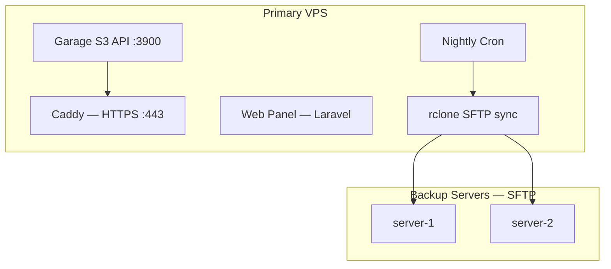

- **Orchestration runs only on the primary VPS** (push model). Backup servers only need SSH/SFTP and disk space.
- Default S3 credentials for applications are stored in `/etc/johnny/credentials/default-s3.env`.
- An internal backup key (`johnny-backup`) lives in `/etc/johnny/credentials/backup-internal-s3.env` and is scoped to local `http://127.0.0.1:3900`.

---

## Requirements

- **Ubuntu 24.04 LTS** on the primary VPS
- **DNS** `A`/`AAAA` record pointing your chosen hostname to the server **before** installation (Let's Encrypt needs to validate the domain)
- For each backup target: **SSH/SFTP** reachable from the primary, with a user that can write under the remote path

---

## Quick Start (Autoinstall)

Clone **outside `/root`** (e.g. `/opt/johnny`) so the Laravel panel can run as `www-data`:

```bash
sudo mkdir -p /opt && sudo git clone https://github.com/andreapollastri/johnny /opt/johnny
cd /opt/johnny
sudo bash scripts/autoinstall.sh
```

The interactive wizard will:

1. Install dependencies (Python 3, Caddy, rclone, …) and run `scripts/install.sh` (Garage v2.4.1 by default; override with `GARAGE_VERSION=vX.Y.Z`)
2. Start Garage and bootstrap a single-node layout
3. Create bucket `default`, API keys `johnny-default` (apps) and `johnny-backup` (nightly sync), and write env files under `/etc/johnny/credentials/`
4. Configure **Caddy** with automatic TLS for your S3 domain
5. Create `/etc/johnny/backup.json` (retention: 90 days, empty targets)
6. Install `/etc/cron.d/johnny-nightly` (server packages at 02:00, Johnny update at 02:30, backup at 03:00 — see [Updating](#updating))
7. Optionally install the **web panel** (PHP 8.6-FPM, Composer, Laravel migrate, Caddy vhost)

Once complete, load your app credentials:

```bash
source /etc/johnny/credentials/default-s3.env
aws s3 ls --endpoint-url "$AWS_ENDPOINT_URL"
```

---

## Manual Install (Without Autoinstall)

```bash
sudo bash scripts/install.sh
sudo systemctl start johnny-garage
sudo bash scripts/bootstrap-single-node.sh
```

Then configure TLS yourself — see `config/caddy-johnny.caddy.example` or `config/nginx-johnny-s3.conf.example`. Create credentials and keys with `sudo -u johnny johnny key create …` as needed.

---

## Web Panel

The optional Laravel panel is a quiet, keyboard-friendly interface to everything on the node: **buckets**, **objects**, **access keys**, and **transfers** to and from other providers. One bar on top, light and dark, no build step.

| | |
|---|---|
| 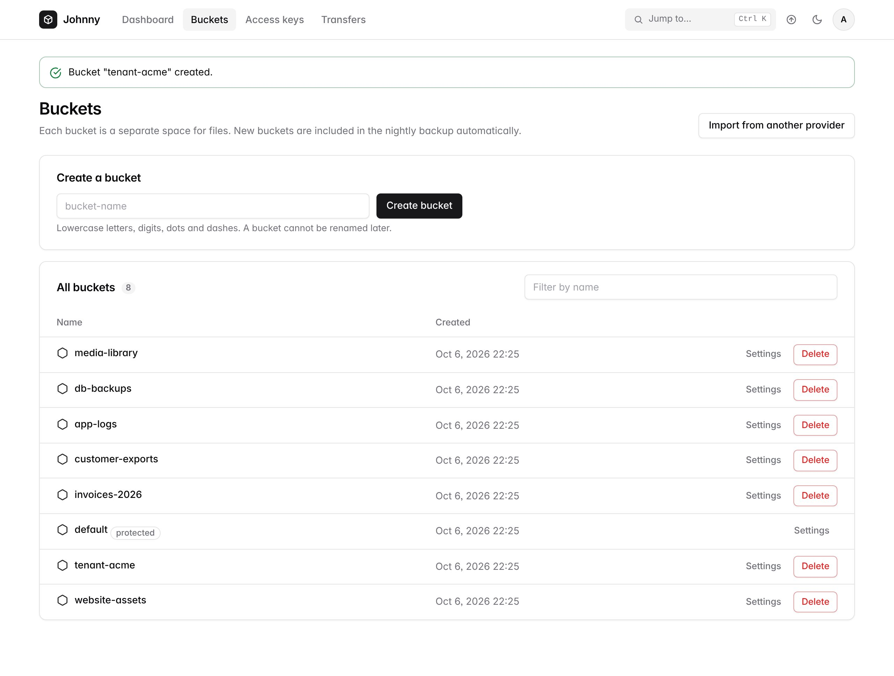 |  |
| **Buckets** — create, filter, delete (the `default` bucket is protected) | **Objects** — folders, drag and drop of files and folders, resumable uploads, bulk delete |
|  |  |
| **Preview and share** — images, video, audio, PDF and text; rename, move, share links up to 7 days | **Settings** — quotas (size, objects), expiry rules, CORS |
| 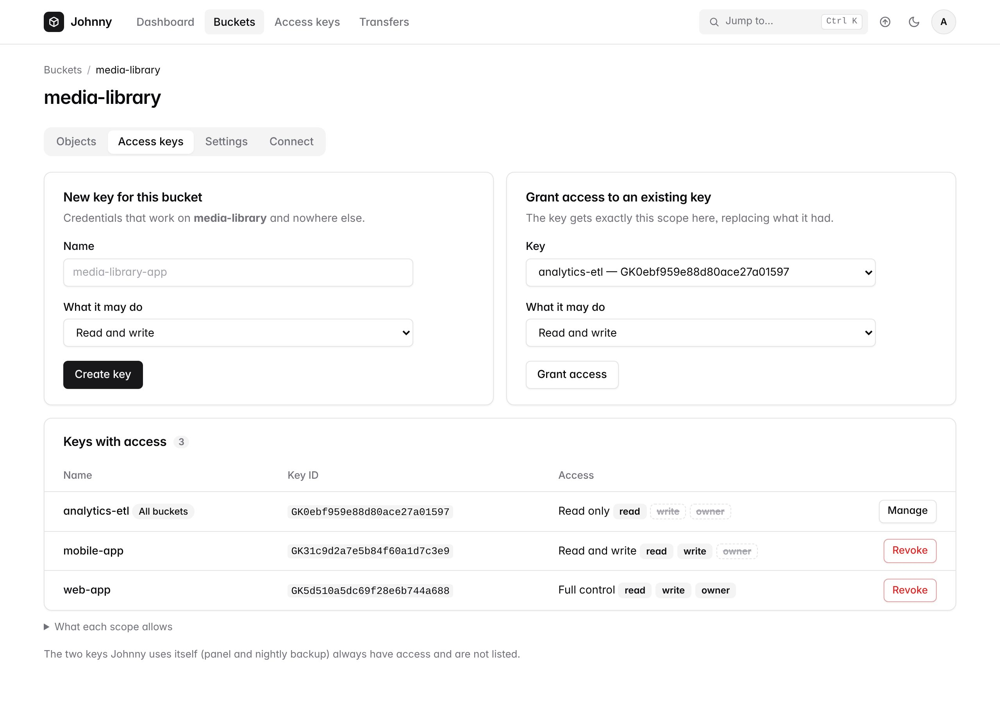 |  |
| **Bucket access** — a new key for this bucket, or a scope for an existing one | **Access keys** — credentials shown once, with ready-to-paste snippets |
| 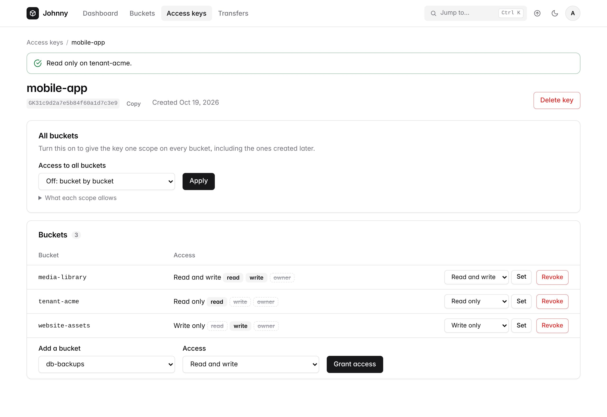 |  |
| **A key** — its buckets and scopes, or one scope on all buckets | **Transfers** — connections, scheduled syncs, history |
| 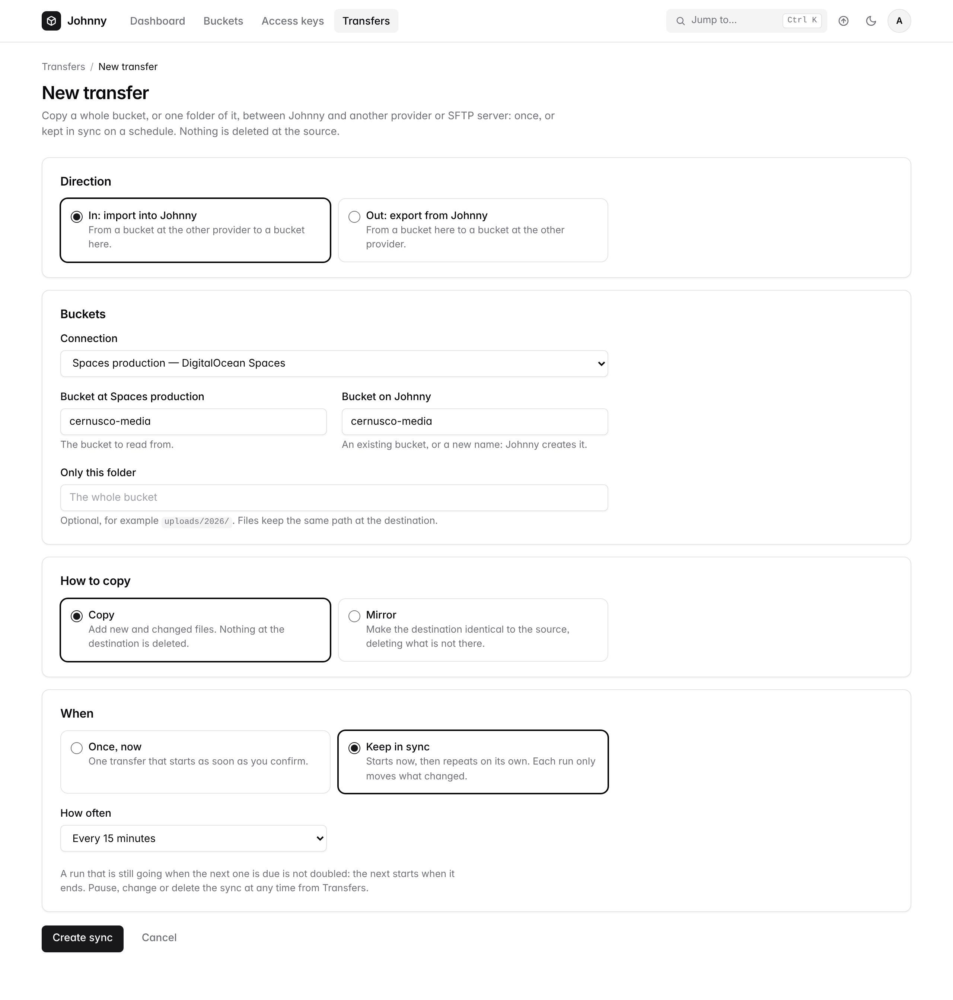 | 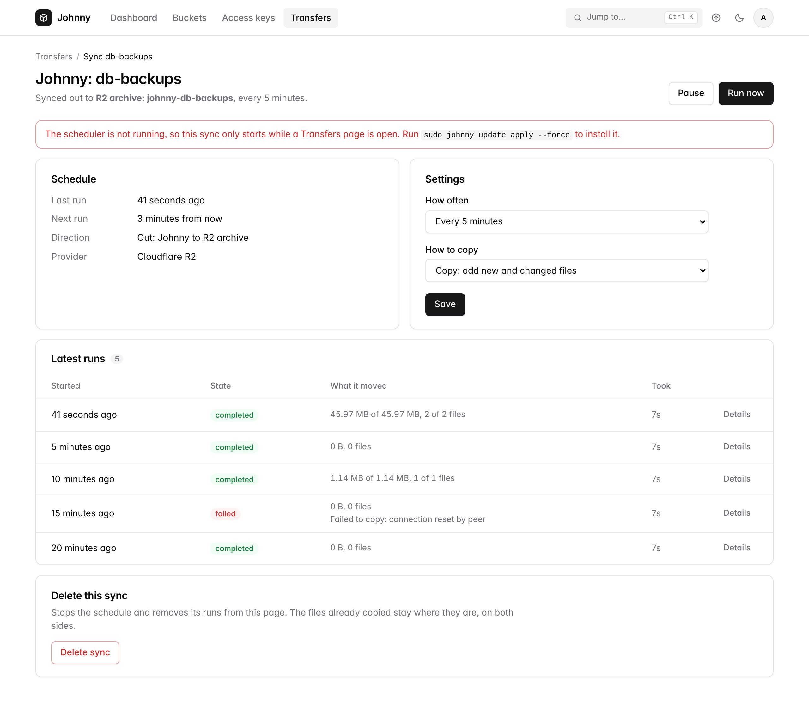 |
| **New transfer** — in or out, copy or mirror, once or kept in sync | **A sync** — schedule, pause, run now, latest runs |
| 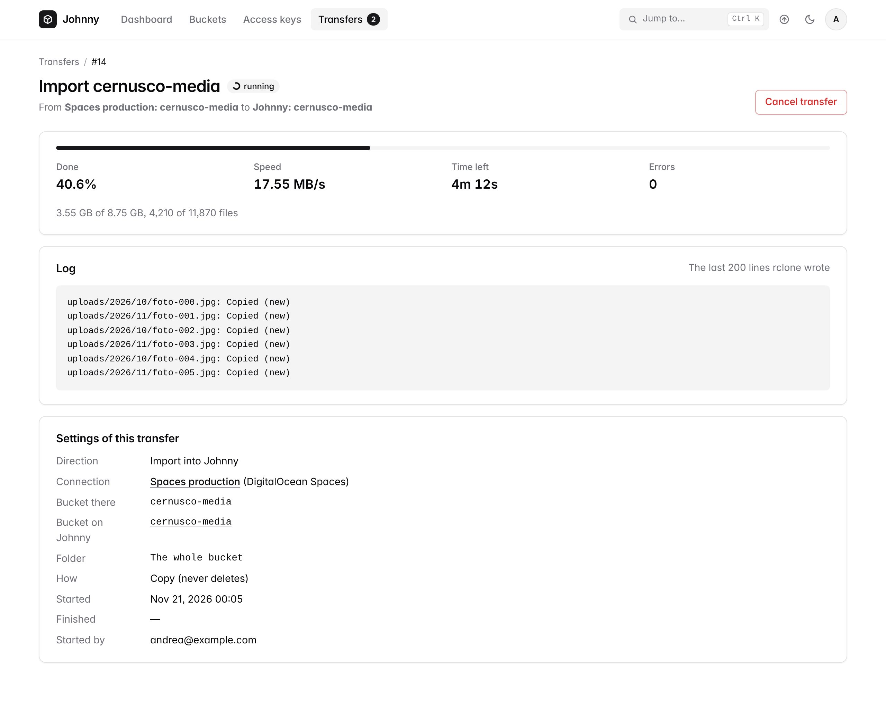 | 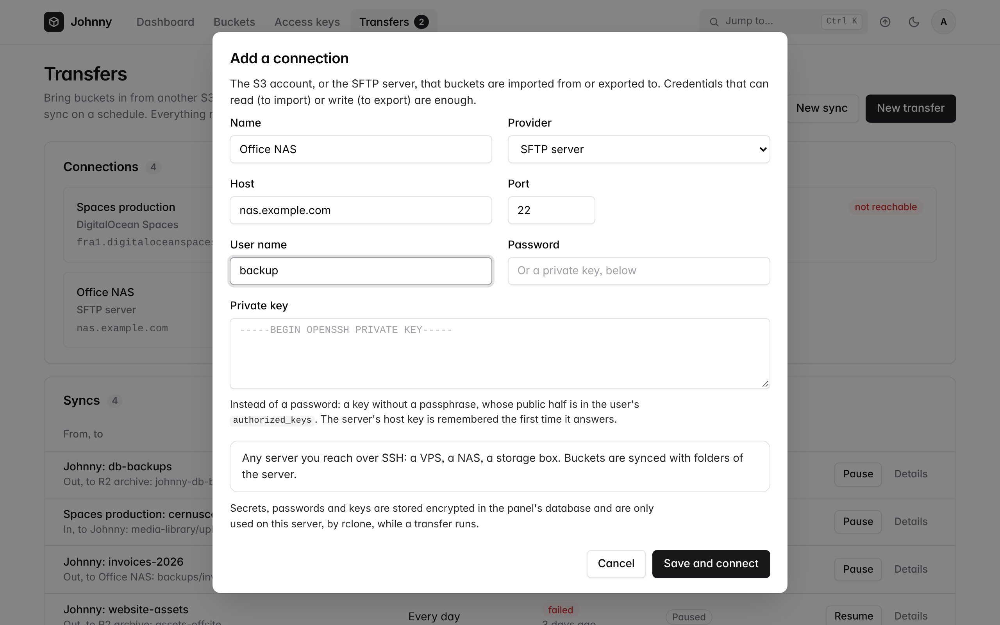 |
| **A transfer** — live progress, speed, log, cancel | **Connections** — S3 providers and SFTP servers |
| 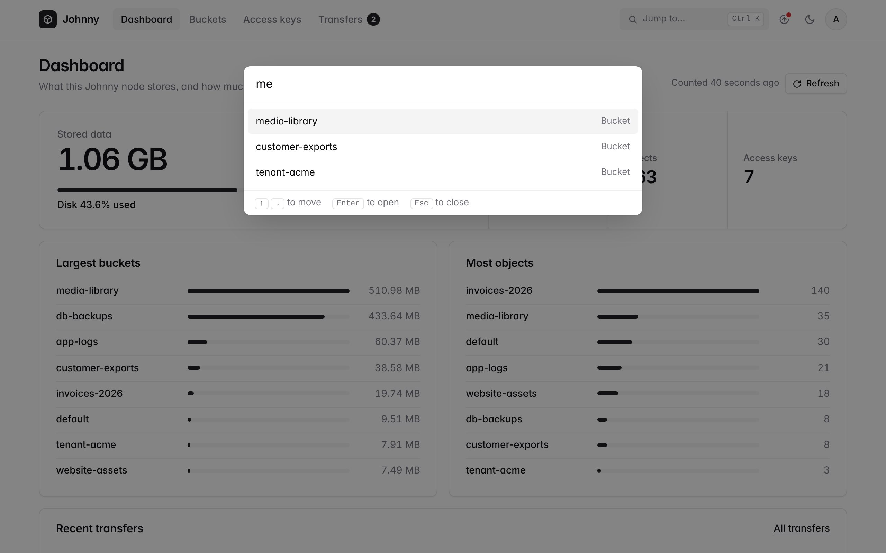 | 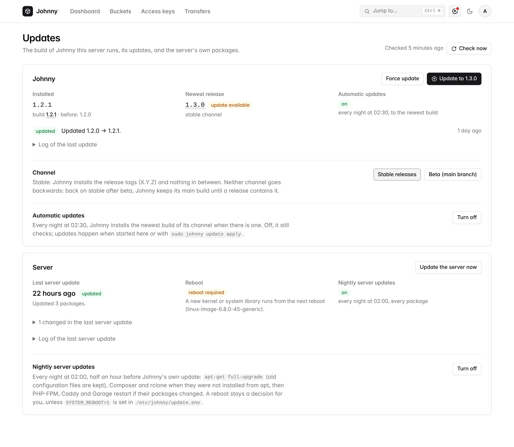 |
| **Jump to…** — `Ctrl`/`⌘` + `K` or `/`: any page or bucket by name | **Updates** — channel, nightly updates, server packages |
| 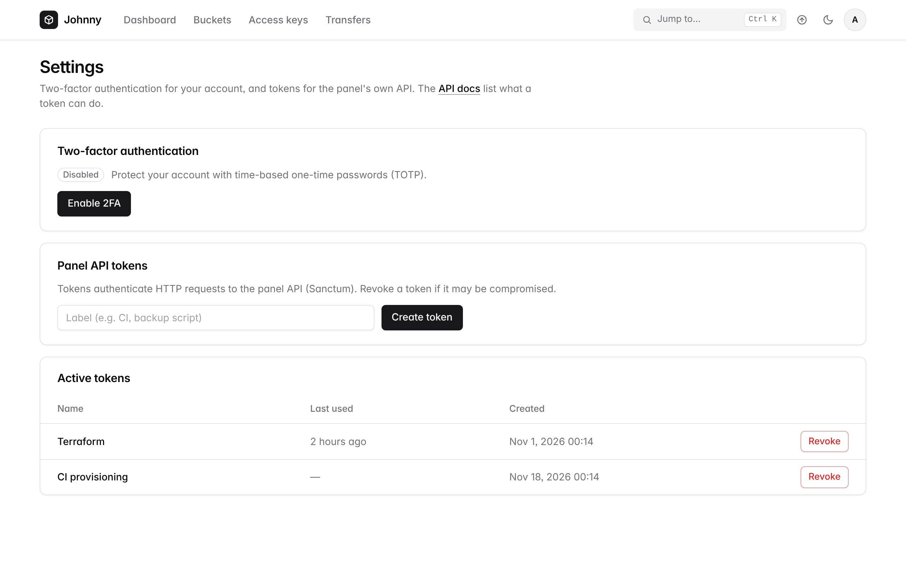 | 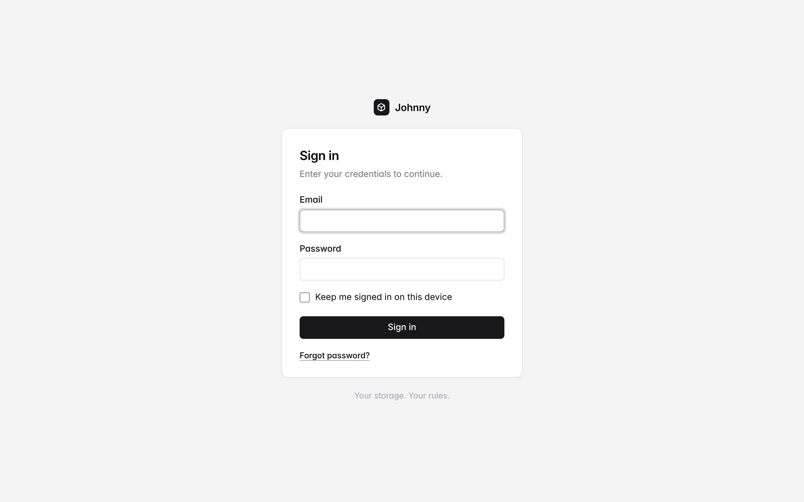 |
| **Settings** — TOTP 2FA and API tokens | **Sign in** — password reset by email, two-factor challenge |

What the panel does, page by page:

- **Dashboard** — stored data, disk space, largest buckets, latest transfers.
- **Buckets → Objects** — folders, drag and drop of files and folders, resumable uploads in chunks (no `php.ini` limits to raise), previews (images, video, audio, PDF, text), rename/move, bulk delete, temporary share links (presigned URLs, up to 7 days), filter by name prefix.
- **Buckets → Access keys** — create a key for one bucket, or grant an existing key a scope there.
- **Buckets → Settings** — quotas (size, object count), expiry rules (delete after N days, abort incomplete multipart uploads), CORS.
- **Buckets → Connect** — ready-to-paste configuration for Laravel, AWS CLI, rclone, Python and Node.js.
- **Access keys** — keys for chosen buckets or for all buckets, each with one scope — see [Access keys and scopes](#access-keys-and-scopes).
- **Transfers** — import and export buckets from and to other S3 providers and SFTP servers, once or on a schedule — see [Transfers and scheduled syncs](#transfers-and-scheduled-syncs).
- **Jump to…** (`Ctrl`/`⌘` + `K`, or `/`) — go to any page or bucket by typing its name.

The **Updates** page (arrow icon in the bar) shows the installed version and lets you check, start and configure updates of Johnny and of the server's packages — see [Updating](#updating). The panel has no roles: every signed-in user is an administrator and can use it.

### Install the Panel

If you chose to skip the panel during autoinstall, you can add it later:

```bash
sudo bash scripts/install-panel.sh /opt/johnny https://panel.example.com
```

The script installs PHP 8.6-FPM, Composer, runs Laravel migrations and caches, and wires the Garage credentials from `/etc/johnny/credentials/default-s3.env` into `panel/.env`.

See `config/caddy-panel.caddy.example` for the Caddy vhost configuration.

### Panel Environment

Besides the Laravel defaults, `panel/.env` supports:

| Variable | Default | Purpose |
|---|---|---|
| `GARAGE_ACCESS_KEY_ID` / `GARAGE_SECRET_ACCESS_KEY` | from `default-s3.env` | S3 key used by the panel (`johnny-default`) |
| `GARAGE_ENDPOINT` / `GARAGE_DEFAULT_REGION` | from `default-s3.env` / `johnny` | Public S3 URL and region (also returned by the provisioning API) |
| `GARAGE_KEY_NAME` | `johnny-default` | Key granted on every bucket created from the panel or API |
| `GARAGE_DATA_DIR` | `/var/lib/johnny/data` | Filesystem shown in the dashboard disk gauge |
| `JOHNNY_CLI_BINARY` | `/usr/local/bin/johnny` | CLI used for buckets, keys and permissions |
| `JOHNNY_CLI_SUDO_USER` | `johnny` | Run the CLI as this user via `sudo -n`; empty to call it directly |
| `GARAGE_INTERNAL_ENDPOINT` | *(empty)* | Endpoint rclone uses for the Johnny side of a transfer, e.g. `http://127.0.0.1:3900` to skip the reverse proxy; empty uses `GARAGE_ENDPOINT` |
| `JOHNNY_RCLONE_BINARY` | `rclone` | rclone binary that runs transfers and syncs |
| `JOHNNY_PHP_BINARY` | *(detected)* | PHP CLI that runs a transfer in the background; set it when the web server's PHP is not the one on the `PATH` |
| `JOHNNY_TRANSFER_CONCURRENCY` | `2` | Transfers running at the same time; the others wait their turn |
| `JOHNNY_UPDATE_STATE` | `/var/lib/johnny-update/state.json` | State of the updater, read by the **Updates** page |
| `JOHNNY_UPDATE_SUDO` | `true` | Run `johnny update …` through `sudo -n` (as root); `false` calls it directly |
| `JOHNNY_VERSION_FILE` | `../VERSION` | Version shown as *Installed* on the **Updates** page |
| `JOHNNY_REPOSITORY_URL` | `https://github.com/andreapollastri/johnny` | Release and commit links when the updater has not recorded its repository yet |
| `APP_TIMEZONE` | `UTC` | Timezone for dates shown in the panel |

Dashboard statistics require listing every object, so they are cached for 60 seconds; use **Refresh** on the dashboard to recompute them.

### Create an Admin User

```bash
sudo -u www-data php /opt/johnny/panel/artisan johnny:admin you@example.com 'strong-password'
```

Open `https://<panel-hostname>` and sign in. Open **Settings** (account menu, top right) to enable **two-factor authentication** (TOTP).

### Access keys and scopes

A key gets one **scope** on each bucket it can use:

| Scope | Garage permissions | What the key can do |
|---|---|---|
| Read only | `read` | List and download objects |
| Read and write | `read` + `write` | List, download, upload, overwrite and delete objects |
| Write only | `write` | Upload, overwrite and delete, without reading back |
| Full control | `read` + `write` + `owner` | Everything above, plus bucket settings (CORS, expiry rules) and deleting the bucket |

Garage enforces `read`, `write` and `owner` and nothing finer: there is no permission to allow uploads but forbid overwriting or deleting. To protect files from removal, hand out read-only keys.

A key works on:

- **Selected buckets** — picked when the key is created (**Access keys**), or from a bucket's **Access keys** tab, which can also create a key for that bucket alone.
- **All buckets** — a *global* key. Garage has no such notion, so the panel records the key and grants it on every bucket: the existing ones at once, new ones when they are created from the panel or the API. Buckets created elsewhere (the CLI, an S3 client) are picked up within five minutes by the scheduler, or right away with `php artisan johnny:keys:apply` (`--all` grants on every bucket again).

The page of a key lists its buckets and lets you change the scope, bucket by bucket or for all buckets at once.

### Transfers and scheduled syncs

**Transfers** copies buckets between Johnny and any other S3 provider (AWS S3, Cloudflare R2, DigitalOcean Spaces, Backblaze B2, Wasabi, Hetzner, Scaleway, MinIO, another Johnny, or any S3-compatible endpoint), or an **SFTP server** (a VPS, a NAS, a storage box), where a bucket is synced with a folder:

1. **Add a connection** — endpoint, region and access key of the other provider; or host, port, user and a password or private key for an SFTP server. Secrets are stored encrypted and never shown again. The host key of an SFTP server is pinned the first time it answers: a different server at the same address is refused until you save the connection again.
2. **New transfer** — direction (**in**: import into Johnny, **out**: export from Johnny), the two buckets, optionally one folder, and **Copy** (add new and changed files) or **Mirror** (also delete what the source no longer has). A **dry run** lists what would change without touching anything. Several buckets of a provider can be imported at once from the connection's page.
3. **When** — *Once, now*, or **Keep in sync**: the transfer repeats every minute, 5/15/30 minutes, hour, 6/12 hours, day, week, or any number of minutes, hours or days. Runs of the same sync never overlap; a sync can be paused, run on demand, changed or deleted from its page.

With an SFTP server, the other side of a transfer is a path: `backups/media` (inside the folder the user lands in) or `/srv/backups/media`; folders that do not exist are created. Files are compared by size and checksum; a server that cannot hash files (no shell access) is compared by size alone.

Transfers are run by [rclone](https://rclone.org/) in the background (data goes from one provider to the other through the server, not through your browser), so you can close the page; progress, speed and the log are shown live, and a transfer can be cancelled or started again (files already copied are skipped).

SFTP connections also use `ssh-keyscan` (package `openssh-client`, installed by autoinstall) to read the server's host key.

Scheduled syncs need the panel's scheduler, `/etc/cron.d/johnny-panel`:

```cron
* * * * * www-data php /opt/johnny/panel/artisan schedule:run >/dev/null 2>&1
```

`scripts/install-panel.sh` installs it, and migration `009` adds it to servers updated from 1.2.x. Without it, syncs only start while a Transfers page is open, and the page says so.

### API Keys via the Panel

The Keys page calls `sudo -u johnny johnny key list` under the hood. `/etc/sudoers.d/johnny-panel` lets the PHP-FPM user (`www-data`) run:

- the Garage CLI as `johnny` (buckets, keys, permissions)
- as root, only these exact command lines, for the **Updates** page (no wildcards: sudo matches the arguments as written): `johnny update status`, `check`, `start`, `start --force`, `channel stable`, `channel beta`, `auto on`, `auto off`, `system-start`, `system-auto on`, `system-auto off`

`scripts/install-panel.sh` (run by autoinstall) installs it; on a 1.1.x server, migration `008` adds the update lines to the existing file. For manual installs, copy the example (change `www-data` if PHP-FPM runs as another user):

```bash
sudo visudo -cf config/johnny-panel.sudoers.example
sudo install -m 0440 config/johnny-panel.sudoers.example /etc/sudoers.d/johnny-panel
```

<a id="panel-api"></a>

### Provisioning API

When the panel is installed, it exposes a **JSON API** to provision a new Garage bucket together with a fresh S3 key scoped to that bucket. This is useful for automation (onboarding tenants, CI, internal tools) without logging into the UI for each bucket.

**Authentication:** [Laravel Sanctum](https://laravel.com/docs/sanctum) personal access tokens. Create a token in the panel under **Settings → Panel API tokens**, or issue one from the server:

```bash
sudo -u www-data php /opt/johnny/panel/artisan johnny:api-token you@example.com --name=provisioning
```

Send the token on every request:

```http
Authorization: Bearer <your-token>
Accept: application/json
```

**Interactive docs (no token required):** open `GET /api/docs` in a browser for Swagger UI. The machine-readable OpenAPI 3 spec is at `GET /api/openapi.yaml`.

**Endpoint:** `POST /api/buckets/provision`  
Use your panel base URL, for example `https://panel.example.com/api/buckets/provision`.

**Request body (JSON, optional):**

| Field | Type | Description |
|---|---|---|
| `bucket` | string, optional | Bucket name. Must match `^[a-z0-9][a-z0-9._-]{1,254}$`. If omitted, a unique name is generated (prefix `b-` plus random hex). |
| `scope` | string, optional | What the dedicated key may do in its bucket: `read`, `read-write`, `write` or `full` (default `full`: read, write and owner). |

Example body: `{}`, `{"bucket":"my-tenant-data"}` or `{"bucket":"reports","scope":"read-write"}`.

**Success (HTTP 201):** the response is a JSON object including:

| Field | Description |
|---|---|
| `bucket` | Created bucket name |
| `region` | From `GARAGE_DEFAULT_REGION` in `panel/.env` (default `johnny`) |
| `endpoint` | Public S3 URL from `GARAGE_ENDPOINT` (same as app-facing HTTPS endpoint) |
| `path_style` | `true` — use path-style addressing for S3 clients |
| `key_name` | Garage key name: `{bucket}-{random hex}` (bucket prefix truncated to fit Garage limits) |
| `scope` | The scope the key got on the bucket |
| `credentials` | `access_key_id` and `secret_access_key` for S3 |
| `env` | Convenience map: `AWS_ACCESS_KEY_ID`, `AWS_SECRET_ACCESS_KEY`, `AWS_DEFAULT_REGION`, `AWS_ENDPOINT_URL` |

The server creates the bucket, creates the key, grants that key its scope on the bucket (read/write/owner by default), and grants the panel’s Garage key (`GARAGE_KEY_NAME`, default `johnny-default`) full access so the UI can manage the bucket.

**Errors:** validation failures return **422** with `message` and `detail`. Other failures may return **422** (bucket creation) or **500** (key creation or permission steps) with a JSON body describing the problem.

**Example:**

```bash
curl -sS -X POST "https://panel.example.com/api/buckets/provision" \
  -H "Authorization: Bearer YOUR_SANCTUM_TOKEN" \
  -H "Accept: application/json" \
  -H "Content-Type: application/json" \
  -d '{"bucket":"customer-orders"}'
```

**Requirements:** the panel database must include Sanctum’s `personal_access_tokens` table (run `php artisan migrate` after upgrades). PHP must be allowed to run `sudo -u johnny /usr/local/bin/johnny` as for the rest of the panel (see **API Keys via the Panel** above).

### Panel API reference

Same **Sanctum** authentication as provisioning (`Authorization: Bearer …`, `Accept: application/json`). The full contract, with every field and response, is the OpenAPI spec served at `/api/openapi.yaml` and rendered by Swagger UI at `/api/docs`.

Reads answer `{"data": …}`, errors `{"message": "…", "detail": "…"}`. `422` is a validation error, `409` a resource that is busy or in use, `404` an unknown bucket, key or id. Sizes are bytes, intervals minutes, dates ISO 8601.

**Buckets and their settings**

| Method | Path | Description |
|--------|------|-------------|
| `GET` | `/api/buckets` | List buckets (S3 `ListBuckets`). |
| `POST` | `/api/buckets` | Create a bucket: `{"name":"my-bucket"}`. System keys and keys for all buckets are granted on it. |
| `GET` | `/api/buckets/{bucket}` | Size, object count, quotas and the keys that can use the bucket, each with its `scope`. |
| `DELETE` | `/api/buckets/{bucket}` | Delete an empty bucket (the `default` bucket is protected). |
| `GET` | `/api/buckets/{bucket}/settings` | Usage, quotas, CORS rule and expiry rules in one call. |
| `PUT` | `/api/buckets/{bucket}/quotas` | `{"max_size": 10737418240, "max_objects": null}` — bytes and a count; `null` removes a limit. |
| `PUT` | `/api/buckets/{bucket}/cors` | `{"origins":["https://app.example.com"],"methods":["GET","PUT"]}`; an empty `origins` removes the rule. |
| `PUT` | `/api/buckets/{bucket}/lifecycle` | `{"expire_days": 30, "expire_prefix": "tmp/", "abort_days": 7}`; `null` turns a rule off. |

**Keys and scopes**

| Method | Path | Description |
|--------|------|-------------|
| `GET` | `/api/scopes` | The scopes (`read`, `read-write`, `write`, `full`) and the Garage permissions behind each. |
| `GET` | `/api/keys` | List keys, with `all_buckets` and `scope` for the global ones (system keys are omitted). |
| `POST` | `/api/keys` | Create a key and grant it in one call: `{"name":"reports","access":"buckets","scope":"read","buckets":["media"]}`, or `"access":"all"` for every bucket. The secret is returned once. |
| `GET` | `/api/keys/{keyId}` | One key by exact id, with the buckets it can use and their scopes. System keys return **403**. |
| `DELETE` | `/api/keys/{keyId}` | Delete a key (system keys **403**). |
| `PUT` | `/api/keys/{keyId}/all-buckets` | `{"scope":"read"}` — exactly this scope on every bucket, new ones included. |
| `DELETE` | `/api/keys/{keyId}/all-buckets` | Stop granting the key on new buckets; what it has stays. |
| `POST` | `/api/buckets/{bucket}/keys` | Grant a key on one bucket: `{"key_id":"GK…","scope":"read-write"}` (exact), or `read` / `write` / `owner` flags (added to what it has). |
| `DELETE` | `/api/buckets/{bucket}/keys/{keyId}` | Revoke permissions: pass the flags to remove (query string or JSON body). System keys return **403**. |

**Connections, transfers and syncs**

| Method | Path | Description |
|--------|------|-------------|
| `GET` | `/api/providers` | Supported providers and what each needs (endpoint, region, path-style). |
| `GET` `POST` | `/api/connections` | List connections; add one (S3 account or SFTP server). Secrets are never returned. |
| `GET` `PUT` `DELETE` | `/api/connections/{id}` | Read, change or delete a connection (**409** while a transfer or a sync uses it). |
| `POST` | `/api/connections/{id}/check` | Try the credentials: `{"reachable": true, "error": null}`. |
| `GET` | `/api/connections/{id}/buckets` | The buckets of the provider, or the folders of the SFTP server. |
| `GET` `POST` | `/api/transfers` | List transfers (`?status=`, `?sync_id=`, `?limit=`); start an import or an export. |
| `GET` `DELETE` | `/api/transfers/{id}` | Progress, counters and log (poll while `active` is true); remove a finished one. |
| `POST` | `/api/transfers/{id}/cancel` | Cancel a waiting or running transfer. |
| `POST` | `/api/transfers/{id}/retry` | Run it again; `{"for_real": true}` turns a dry run into a real one. |
| `GET` `POST` | `/api/syncs` | List scheduled syncs (with `scheduler_running`); create one with `interval_minutes`. |
| `GET` `PUT` `DELETE` | `/api/syncs/{id}` | A sync with its latest runs; change `interval_minutes` / `mode`, pause or resume with `enabled`; delete. |
| `POST` | `/api/syncs/{id}/run` | Run a sync now (**409** while a run is in progress). |

Start a sync out to an SFTP server and follow its first run:

```bash
API=https://panel.example.com/api; AUTH="Authorization: Bearer $TOKEN"

curl -s -X POST "$API/connections" -H "$AUTH" -H 'Accept: application/json' -H 'Content-Type: application/json' \
  -d '{"name":"Office NAS","provider":"sftp","host":"nas.example.com","username":"backup","password":"…"}'

curl -s -X POST "$API/syncs" -H "$AUTH" -H 'Accept: application/json' -H 'Content-Type: application/json' \
  -d '{"direction":"export","connection_id":1,"local_bucket":"media","remote_bucket":"backups/media","mode":"copy","interval_minutes":15}'

curl -s "$API/syncs/1" -H "$AUTH" -H 'Accept: application/json'   # .data.runs[0].status
```

Objects themselves are read and written with the S3 API of the storage endpoint, using an access key. Garage does not support renaming buckets or keys; there are no routes for that.

---

## Local Demo

Run the whole stack on your laptop — useful for evaluating Johnny, developing the panel, or regenerating the screenshots above. Nothing is installed system-wide; all state lives in `demo/.state/`.

```bash
brew install garage        # or put a Garage 2.x binary in PATH / set GARAGE_BIN
bash demo/up.sh            # Garage + ~1 GB of sample data + panel on http://127.0.0.1:8099
bash demo/down.sh --wipe   # stop and delete the demo data
```

Sign in with `demo@johnny.test` / `johnny-demo`. The seed creates eight buckets, seven application keys with different permissions, three API tokens, and provisions `tenant-acme` through the real REST API. Regenerate the documentation screenshots with `npm --prefix demo install && node demo/screenshots.mjs`. Details: [`demo/README.md`](demo/README.md).

---

## Development

```bash
cd panel
composer install
composer test              # PHPUnit: CLI parsers (real Garage 2.4 output), web UI, API, security guards
vendor/bin/pint            # code style
php artisan schedule:work  # scheduled syncs and global keys, without cron
cd .. && python3 -m unittest discover -s scripts/tests
```

GitHub Actions runs the panel tests, Pint, `composer audit`, the Python tests and ShellCheck on every push and pull request.

---

## Configuring SMTP for Password Reset

By default the panel uses `MAIL_MAILER=log`, which means outbound emails (including password-reset links) are **not sent** — they are only written to the Laravel log.

To enable real email delivery, edit `panel/.env` and set the SMTP variables:

```dotenv
MAIL_MAILER=smtp
MAIL_HOST=smtp.example.com
MAIL_PORT=587
MAIL_USERNAME=your-smtp-user@example.com
MAIL_PASSWORD=your-smtp-password
MAIL_SCHEME=tls
MAIL_FROM_ADDRESS=noreply@yourdomain.com
MAIL_FROM_NAME="Johnny Panel"
```

Then rebuild the config cache:

```bash
sudo -u www-data php /opt/johnny/panel/artisan config:cache
```

**Common SMTP providers:**

| Provider | Host | Port | Scheme |
|---|---|---|---|
| **Mailgun** | `smtp.mailgun.org` | 587 | tls |
| **Amazon SES** | `email-smtp.<region>.amazonaws.com` | 587 | tls |
| **Brevo (Sendinblue)** | `smtp-relay.brevo.com` | 587 | tls |
| **Postmark** | `smtp.postmarkapp.com` | 587 | tls |
| **Gmail** | `smtp.gmail.com` | 587 | tls |
| **Generic SMTP** | your provider's host | 465 (ssl) / 587 (tls) | ssl / tls |

Once configured, users can click **"Forgot your password?"** on the login page and receive a reset link via email.

---

## Updating

Johnny updates itself in place, in the git checkout it was installed from (`/etc/johnny/repo.path`), with `scripts/johnny-update` as root — from the panel's **Updates** page, every night, or by hand:

```bash
sudo johnny update check     # what the channel would install (JSON)
sudo johnny update apply     # install it now
sudo johnny update status    # the last check and the last run (JSON)
```

**Channels** (`UPDATE_CHANNEL` in `/etc/johnny/update.env`):

- `stable` (the default) — the newest release tag. Releases are tagged `X.Y.Z`; `vX.Y.Z` and `X.Y` tags are read too, and a tag is installed only when its `VERSION` file says the same version.
- `beta` — the head of the `main` branch, for a server you test on.

Switch with `sudo johnny update channel stable|beta` or on the Updates page. Builds come from `JOHNNY_REPO` in the same file: the checkout's `origin` when it is an `https://`, `ssh://` or `git@` URL, otherwise `https://github.com/andreapollastri/johnny.git`.

An update **never goes backwards**: a build is installed only when it contains the installed commit. Back on stable after beta, Johnny keeps its `main` build until a release contains it — and so does a fresh `git clone`, which runs the head of `main`. When nothing moves, `check` and the Updates page say why: no release yet, the installed build is newer (`behind`), the history differs (`diverged`), or the repository is not reachable.

One update, in order:

1. Fetch the build into the checkout (refused when tracked files have local changes, unless forced)
2. Back up the panel database — SQLite, MySQL/MariaDB or PostgreSQL, from `panel/.env` — into `/var/backups/johnny` (the newest 5 are kept)
3. Panel in maintenance mode, `git checkout --force --detach <build>`
4. The build's install steps (`scripts/update.sh`): scripts to `/usr/local/share/johnny`, panel `composer install` + `artisan migrate` + caches, pending numbered migrations from `scripts/migrations/`, system keys on every bucket
5. Maintenance off, PHP-FPM reloaded, health check (`garage status`; the panel boots and, when this server's Caddy serves it, answers `/up`)

If a step after the checkout fails (the health check included), the previous commit is checked out again, the panel database is restored from the backup, and its install steps run again. A failure before the checkout (the repository not reachable, a tag whose `VERSION` does not match, the backup) changes nothing. One run at a time: the nightly runs wait for each other, and the panel's buttons are disabled while one is under way.

**Force update** (`sudo johnny update apply --force`, or the button in the panel) installs the channel's newest build again even when it is the installed one, and also when the history differs; it discards local changes to tracked files. It never installs an older build.

**Nightly** (`/etc/cron.d/johnny-nightly`), logged to `/var/log/johnny-update.log`:

| Time | Command | Switch |
|---|---|---|
| 02:00 | `johnny update system --auto` — `apt-get full-upgrade` (keeping old config files), Composer and rclone self-update when not installed from apt, restart of PHP-FPM / Caddy / Garage only when their packages changed, health check | `sudo johnny update system-auto on\|off` (`SYSTEM_UPDATE`) |
| 02:30 | `johnny update apply --auto` — the newest build of the channel | `sudo johnny update auto on\|off` (`AUTO_UPDATE`) |
| 03:00 | SFTP backup | — |

With a switch off, the nightly line still runs: `apply --auto` only checks (the Updates page stays current), `system --auto` does nothing. *Update* and *Update the server now* on the panel, and `apply` / `system` by hand, run whatever the switches say.

**Server update** (`sudo johnny update system`, *Update the server now* on the panel, or nightly at 02:00): `apt-get update`, `full-upgrade` and `autoremove` — Ubuntu and its security fixes, PHP, Caddy, rclone — keeping your changed configuration files; then `composer self-update` and `rclone selfupdate` when they were not installed from apt; then PHP-FPM, Caddy and `johnny-garage` restart only if their packages changed, and the health check runs (with one more restart of all three if Johnny does not answer). The Updates page lists what changed. Garage itself is a binary installed by `scripts/install.sh` (`GARAGE_VERSION`), not an apt package: neither update changes its version. A server update that needs a reboot (`/run/reboot-required`) says so on the Updates page with the packages that need it; Johnny never reboots on its own unless you set `SYSTEM_REBOOT=1` in `/etc/johnny/update.env`, and then only after a nightly run that needs it, 5 minutes later.

`/etc/johnny/update.env` (written with these defaults on the first run; `channel`, `auto` and `system-auto` edit it, `SYSTEM_REBOOT` and `JOHNNY_REPO` are edited by hand):

```dotenv
UPDATE_CHANNEL=stable   # or beta
AUTO_UPDATE=1           # Johnny, nightly at 02:30
SYSTEM_UPDATE=1         # server packages, nightly at 02:00
SYSTEM_REBOOT=0         # 1: reboot 5 minutes after a nightly server update that needs it
JOHNNY_REPO=https://github.com/andreapollastri/johnny.git
```

**From 1.2.x — nothing to do.** The update that installs 2.0 migrates the panel's database (connections, transfers, syncs, global keys) and runs three migrations: `009` installs `/etc/cron.d/johnny-panel` where the panel is installed, `010` moves the panel to **PHP 8.6**, `011` takes PHP from packages.sury.org instead of the retired ondrej/php PPA. Existing keys, buckets and permissions are not touched.

The PHP switch (`scripts/switch-php.sh`) installs PHP 8.6 next to 8.5 with the same extensions, carries the FPM pools over, checks that the panel boots on 8.6, then points Caddy and the `php` command at it and stops the PHP 8.5 FPM (its packages stay). If any step fails the panel stays on PHP 8.5, which 2.0 still supports, and the update goes on; run the switch again by hand with `sudo bash /opt/johnny/scripts/switch-php.sh /opt/johnny 8.6`.

**From 1.1.x — nothing to do.** Existing servers move over on their own on the next nightly run: the old line `johnny update --pull` (02:30) pulls `main` one last time, and its install steps run the new migration `008`, which:

- moves `/etc/cron.d/johnny-nightly` to the schedule above (server update at 02:00, Johnny update at 02:30)
- installs `jq` and creates `/var/lib/johnny-update`
- writes `/etc/johnny/update.env` with the defaults: stable channel, automatic updates **and nightly server updates on** (`sudo johnny update system-auto off` if you would rather update packages yourself)
- adds the update commands to `/etc/sudoers.d/johnny-panel` (for the PHP-FPM user already named there), so the panel's Updates page works
- runs a first check, so the Updates page has something to show

From the following night, the server follows the stable channel and updates its packages. To move over at once, run the same command by hand: `sudo johnny update --pull`. On a server set up without autoinstall (no `/etc/cron.d/johnny-nightly`), `008` adds no schedule: add the two `johnny update` lines yourself.

The pull lands on the head of `main`: when that is the `1.2.0` tag, the server runs `1.2.0`; when `main` has newer commits, the server stays on them (`behind`) until the next release contains them. After 1.2.0, `johnny update --pull` still works — it re-runs the install steps of the checkout, then updates like `apply` (from cron, like the nightly `apply --auto`) — and `johnny update` alone re-runs the install steps (`ensure`).

Check the installed version:

```bash
johnny version
```

---

## `johnny` CLI Reference

### General

```bash
sudo johnny version          # Print installed version
sudo johnny status           # Garage cluster status
```

### Updates

| Command | Description |
|---|---|
| `sudo johnny update check` | What the channel would install, as JSON (also records it for the panel) |
| `sudo johnny update apply [--force]` | Install the newest build of the channel (`--force`: again, even when installed; `--auto`: what the nightly runs, a check only while `AUTO_UPDATE=0`) |
| `sudo johnny update status` | The last check and the last run, as JSON |
| `sudo johnny update channel stable\|beta` | Follow the release tags, or the head of `main` |
| `sudo johnny update auto on\|off` | The nightly Johnny update (02:30) |
| `sudo johnny update system` | Update every package of the server now (`--auto`: what the nightly runs, nothing while `SYSTEM_UPDATE=0`) |
| `sudo johnny update system-auto on\|off` | The nightly server update (02:00) |
| `sudo johnny update ensure` | Re-run the install steps of the checked-out build (also: `sudo johnny update`) |
| `sudo johnny update start [--force]` / `system-start` | `apply` / `system` detached through `systemd-run` (what the panel runs) |

### Buckets & Keys (Garage passthrough)

```bash
sudo johnny bucket list
sudo -u johnny johnny bucket create my-bucket
sudo johnny key list
sudo -u johnny johnny key create my-key
```

### Backup Targets (SFTP)

| Command | Description |
|---|---|
| `sudo johnny backup list` | List targets, retention, remote base path |
| `sudo johnny backup create NAME` | Add a target (interactive or with `--host`, `--port`, `--user`, `--password`) |
| `sudo johnny backup delete NAME` | Remove a target |
| `sudo johnny backup update NAME` | Update fields; use `-p` to prompt for a new password |
| `sudo johnny backup set-retention N` | Keep dated folders for N days (default 90) |
| `sudo johnny backup run` | Run the backup job immediately |

Configuration: `/etc/johnny/backup.json` (mode `600`). Passwords are stored in plain text — protect this file.

### Remote Layout After Backups

```text
johnny-backups/
  2026-04-03/
    default/
    my-bucket/
  2026-04-04/
    default/
    my-bucket/
```

Date folders older than `retention_days` are automatically removed.

---

## Nightly Backup Details

- Implemented in `scripts/johnny-nightly-backup.py` (installed to `/usr/local/share/johnny/scripts/`)
- Uses **rclone** to sync `johnny_local:<bucket>` to `sftp:<remote>:<base>/<date>/<bucket>/`
- Ensures key `johnny-backup` has read permission on every bucket before syncing
- Retention is date-based: folders named `YYYY-MM-DD` older than `retention_days` are deleted

Logs: `/var/log/johnny-nightly.log`

---

## S3-to-S3 Replication (Optional)

For Garage-to-Garage replication over S3 (in addition to SFTP backups), use the included scripts:

```bash
# Configure a replication env (see config/replication/media-to-eu.env.example)
cp config/replication/media-to-eu.env.example config/replication/media-to-eu.env
# Edit with your remote Garage credentials, then run:
sudo bash scripts/replicate-run.sh config/replication/media-to-eu.env
```

---

## Security Notes

- Restrict `/etc/johnny` (especially `backup.json` and `credentials/`) — default permissions are already `600`/`700`
- Prefer **SSH keys** on backup servers for production use; Johnny documents password auth for simplicity
- Firewall: expose **443** (and **80** for ACME) only; restrict **22** to trusted IPs where possible
- `rclone sync` can delete extra files on the destination under each dated prefix — see the [rclone sync docs](https://rclone.org/commands/rclone_sync/)
- Every panel user is an administrator and can start updates from the **Updates** page; the PHP-FPM user may run as root only the exact `johnny update …` lines in `/etc/sudoers.d/johnny-panel`

---

## Configuration Reference

| File | Purpose |
|---|---|
| `/etc/johnny/garage.toml` | Garage configuration |
| `/etc/johnny/backup.json` | Backup targets and retention |
| `/etc/johnny/credentials/default-s3.env` | App S3 credentials |
| `/etc/johnny/credentials/backup-internal-s3.env` | Internal backup S3 credentials |
| `/etc/johnny/repo.path` | Path to the Johnny repo (for updates) |
| `/etc/johnny/update.env` | Updates: `UPDATE_CHANNEL` (`stable`/`beta`), `AUTO_UPDATE`, `SYSTEM_UPDATE`, `SYSTEM_REBOOT`, `JOHNNY_REPO` (see [Updating](#updating)) |
| `/etc/johnny/migrations.state` | Last applied migration number |
| `/var/lib/johnny-update/state.json` | Last check and last run of the updater (read by the panel) |
| `/var/backups/johnny/` | Panel database backups taken before each update (newest 5) |
| `/var/log/johnny-update.log` | Update log (Johnny and server updates) |
| `/etc/cron.d/johnny-nightly` | Cron schedule (server update 02:00, Johnny update 02:30, backup 03:00) |
| `/etc/cron.d/johnny-panel` | The panel's scheduler, every minute: scheduled syncs and keys for all buckets |
| `/etc/sudoers.d/johnny-panel` | What the panel may run: the Garage CLI as `johnny`, the update commands as root |
| `panel/.env` | Laravel panel environment (see [Panel Environment](#panel-environment)) |

Example configs are in the `config/` directory of this repository.

---

## License

MIT — see [LICENSE](LICENSE).
