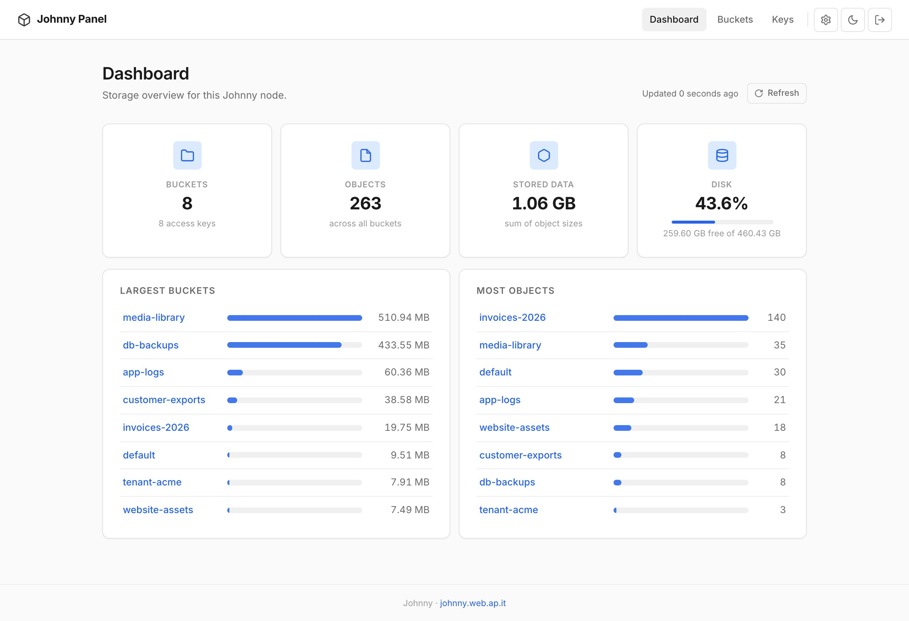
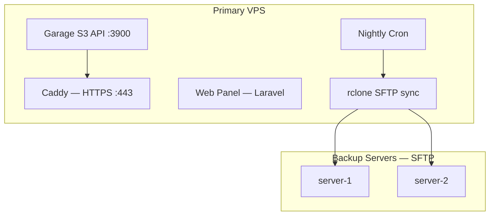
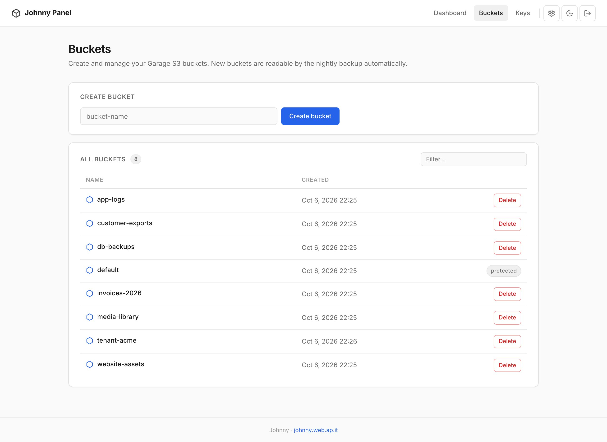
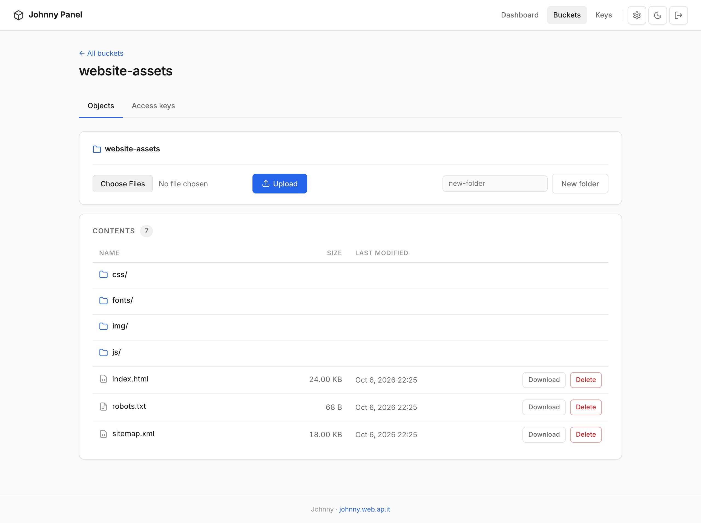
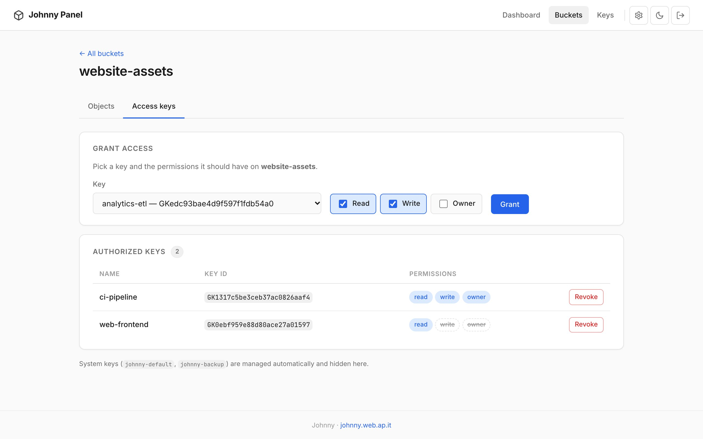
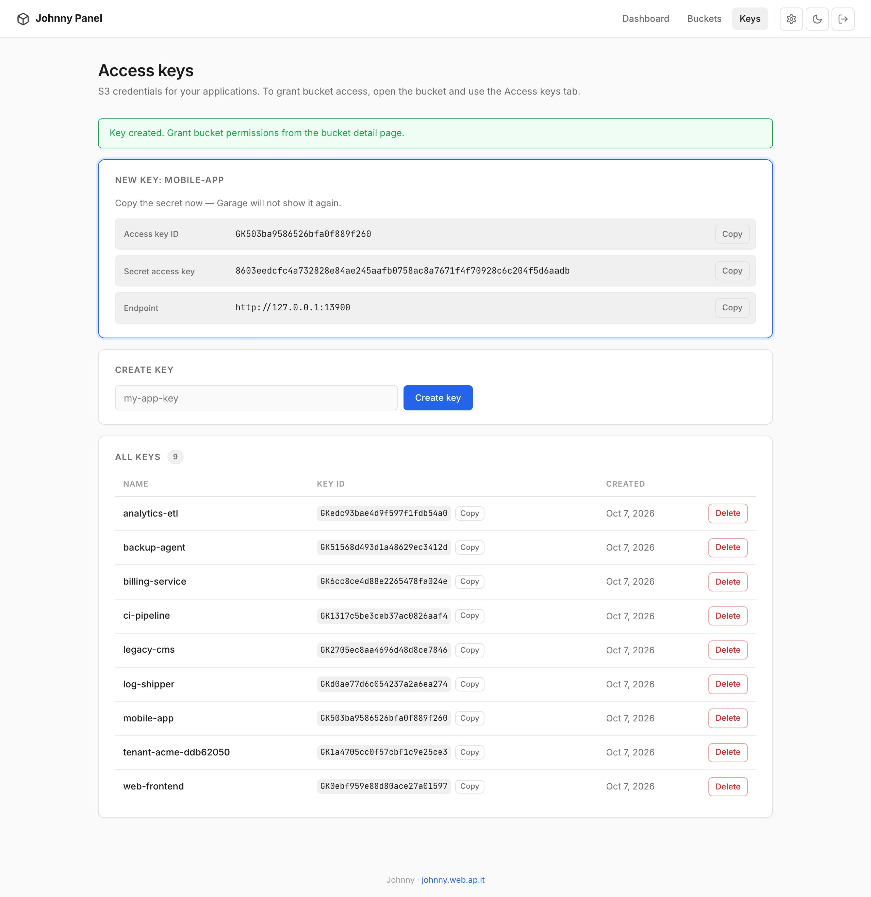
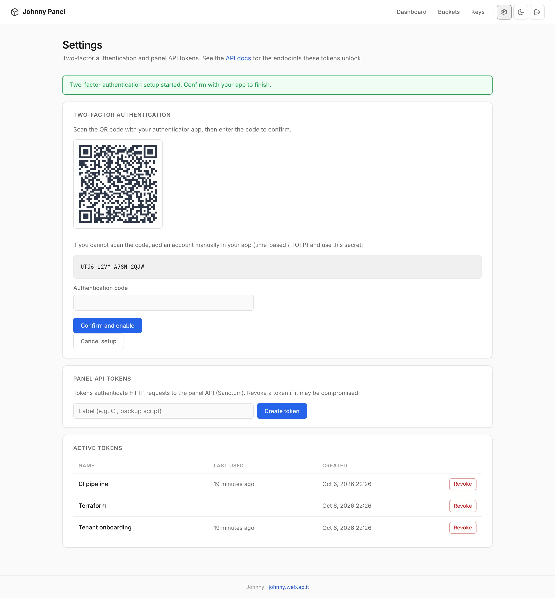
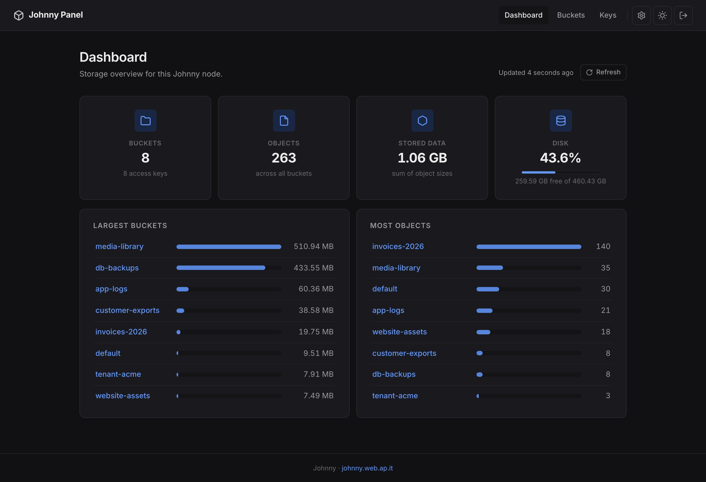
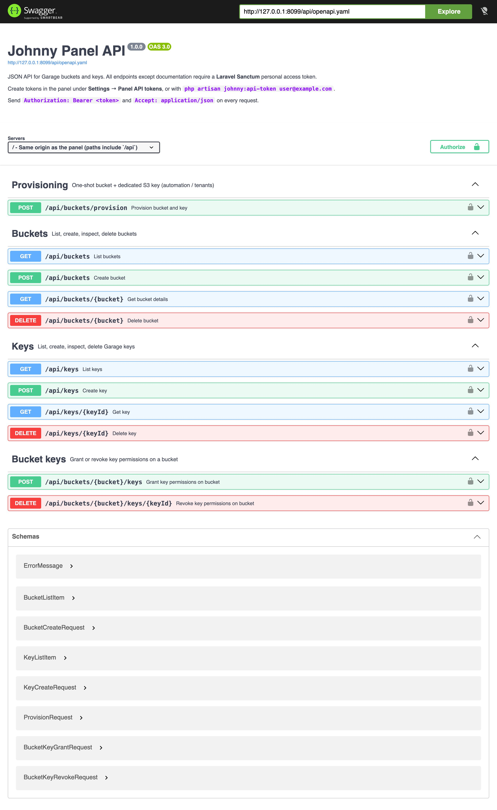

# Johnny

**Self-hosted S3-compatible object storage, automated backups, and an elegant web panel — in one install.**

Johnny wraps [Garage](https://garagehq.deuxfleurs.fr/) with production-ready automation: TLS via Caddy, nightly SFTP backups with retention, a `johnny` CLI, and an optional Laravel web panel with two-factor authentication.

> **Current release:** see [`VERSION`](VERSION) &middot; **License:** [MIT](LICENSE) &middot; **Website:** [johnny.web.ap.it](https://johnny.web.ap.it)



<sub>All screenshots are taken from the [local demo](#local-demo): a real Garage 2.4 node with ~1 GB of sample data.</sub>

---

## Key Features

| | |
|---|---|
| **S3-compatible storage** | Powered by Garage — use any AWS SDK, `aws` CLI, or S3 client |
| **One-command install** | Single script sets up Garage, Caddy (Let's Encrypt TLS), rclone, cron |
| **Automated SFTP backups** | Nightly sync of every bucket to one or more remote servers, with configurable retention |
| **Web panel** | Storage dashboard, file browser (folders, multi-upload, pagination), access keys and per-bucket permissions (optional) |
| **Provisioning API** | Authenticated HTTP endpoint to create a bucket, a dedicated Garage key, and return S3 connection details (optional panel) |
| **Two-factor auth** | TOTP 2FA + password reset via SMTP on the web panel |
| **Self-updating** | Stable releases or the `main` branch (beta), installed every night or from the panel's Updates page — with a database backup and automatic rollback; the server's packages too |
| **Local demo** | `bash demo/up.sh` boots Garage, seeds sample data and serves the panel on your laptop |

---

## Architecture



- **Orchestration runs only on the primary VPS** (push model). Backup servers only need SSH/SFTP and disk space.
- Default S3 credentials for applications are stored in `/etc/johnny/credentials/default-s3.env`.
- An internal backup key (`johnny-backup`) lives in `/etc/johnny/credentials/backup-internal-s3.env` and is scoped to local `http://127.0.0.1:3900`.

---

## Requirements

- **Ubuntu 24.04 LTS** on the primary VPS
- **DNS** `A`/`AAAA` record pointing your chosen hostname to the server **before** installation (Let's Encrypt needs to validate the domain)
- For each backup target: **SSH/SFTP** reachable from the primary, with a user that can write under the remote path

---

## Quick Start (Autoinstall)

Clone **outside `/root`** (e.g. `/opt/johnny`) so the Laravel panel can run as `www-data`:

```bash
sudo mkdir -p /opt && sudo git clone https://github.com/andreapollastri/johnny /opt/johnny
cd /opt/johnny
sudo bash scripts/autoinstall.sh
```

The interactive wizard will:

1. Install dependencies (Python 3, Caddy, rclone, …) and run `scripts/install.sh` (Garage v2.4.1 by default; override with `GARAGE_VERSION=vX.Y.Z`)
2. Start Garage and bootstrap a single-node layout
3. Create bucket `default`, API keys `johnny-default` (apps) and `johnny-backup` (nightly sync), and write env files under `/etc/johnny/credentials/`
4. Configure **Caddy** with automatic TLS for your S3 domain
5. Create `/etc/johnny/backup.json` (retention: 90 days, empty targets)
6. Install `/etc/cron.d/johnny-nightly` (server packages at 02:00, Johnny update at 02:30, backup at 03:00 — see [Updating](#updating))
7. Optionally install the **web panel** (PHP 8.5-FPM, Composer, Laravel migrate, Caddy vhost)

Once complete, load your app credentials:

```bash
source /etc/johnny/credentials/default-s3.env
aws s3 ls --endpoint-url "$AWS_ENDPOINT_URL"
```

---

## Manual Install (Without Autoinstall)

```bash
sudo bash scripts/install.sh
sudo systemctl start johnny-garage
sudo bash scripts/bootstrap-single-node.sh
```

Then configure TLS yourself — see `config/caddy-johnny.caddy.example` or `config/nginx-johnny-s3.conf.example`. Create credentials and keys with `sudo -u johnny johnny key create …` as needed.

---

## Web Panel

The optional Laravel panel provides a browser-based interface to manage **buckets**, **objects**, and **Garage API keys**.

| | |
|---|---|
|  |  |
| **Buckets** — create, filter, delete (the `default` bucket is protected) | **File browser** — folders, multi-file upload, downloads, pagination |
|  |  |
| **Permissions** — grant read / write / owner per bucket | **Access keys** — new credentials are shown once, ready to copy |
|  |  |
| **Settings** — TOTP 2FA and Sanctum API tokens | **Dark mode** — follows the system or the header toggle |

**Updates** (the arrow icon in the header, with a dot when an update is available): the installed version, the newest build of the channel with a link to its release, the stable/beta switch, automatic updates, *Check now*, *Update*, *Force update*, the last run and its log (followed live while it runs), and a **Server** card for the nightly package update and pending reboots — see [Updating](#updating). Every panel user is an administrator, so every user sees it.

### Install the Panel

If you chose to skip the panel during autoinstall, you can add it later:

```bash
sudo bash scripts/install-panel.sh /opt/johnny https://panel.example.com
```

The script installs PHP 8.5-FPM, Composer, runs Laravel migrations and caches, and wires the Garage credentials from `/etc/johnny/credentials/default-s3.env` into `panel/.env`.

See `config/caddy-panel.caddy.example` for the Caddy vhost configuration.

### Panel Environment

Besides the Laravel defaults, `panel/.env` supports:

| Variable | Default | Purpose |
|---|---|---|
| `GARAGE_ACCESS_KEY_ID` / `GARAGE_SECRET_ACCESS_KEY` | from `default-s3.env` | S3 key used by the panel (`johnny-default`) |
| `GARAGE_ENDPOINT` / `GARAGE_DEFAULT_REGION` | from `default-s3.env` / `johnny` | Public S3 URL and region (also returned by the provisioning API) |
| `GARAGE_KEY_NAME` | `johnny-default` | Key granted on every bucket created from the panel or API |
| `GARAGE_DATA_DIR` | `/var/lib/johnny/data` | Filesystem shown in the dashboard disk gauge |
| `JOHNNY_CLI_BINARY` | `/usr/local/bin/johnny` | CLI used for buckets, keys and permissions |
| `JOHNNY_CLI_SUDO_USER` | `johnny` | Run the CLI as this user via `sudo -n`; empty to call it directly |
| `JOHNNY_UPDATE_STATE` | `/var/lib/johnny-update/state.json` | State of the updater, read by the **Updates** page |
| `JOHNNY_UPDATE_SUDO` | `true` | Run `johnny update …` through `sudo -n` (as root) |
| `APP_TIMEZONE` | `UTC` | Timezone for dates shown in the panel |

Dashboard statistics require listing every object, so they are cached for 60 seconds; use **Refresh** on the dashboard to recompute them.

### Create an Admin User

```bash
sudo -u www-data php /opt/johnny/panel/artisan johnny:admin you@example.com 'strong-password'
```

Open `https://<panel-hostname>` and sign in. Open **Settings** (gear in the header) to enable **two-factor authentication** (TOTP).

### API Keys via the Panel

The Keys page calls `sudo -u johnny johnny key list` under the hood. The sudoers rule is installed automatically during autoinstall; for manual installs, copy the example:

```bash
sudo install -m 0440 config/johnny-panel.sudoers.example /etc/sudoers.d/johnny-panel
```

### Provisioning API

When the panel is installed, it exposes a **JSON API** to provision a new Garage bucket together with a fresh S3 key scoped to that bucket. This is useful for automation (onboarding tenants, CI, internal tools) without logging into the UI for each bucket.

**Authentication:** [Laravel Sanctum](https://laravel.com/docs/sanctum) personal access tokens. Create a token in the panel under **Settings → Panel API tokens**, or issue one from the server:

```bash
sudo -u www-data php /opt/johnny/panel/artisan johnny:api-token you@example.com --name=provisioning
```

Send the token on every request:

```http
Authorization: Bearer <your-token>
Accept: application/json
```

**Interactive docs (no token required):** open `GET /api/docs` in a browser for Swagger UI. The machine-readable OpenAPI 3 spec is at `GET /api/openapi.yaml`.



**Endpoint:** `POST /api/buckets/provision`  
Use your panel base URL, for example `https://panel.example.com/api/buckets/provision`.

**Request body (JSON, optional):**

| Field | Type | Description |
|---|---|---|
| `bucket` | string, optional | Bucket name. Must match `^[a-z0-9][a-z0-9._-]{1,254}$`. If omitted, a unique name is generated (prefix `b-` plus random hex). |

Example body: `{}` or `{"bucket":"my-tenant-data"}`.

**Success (HTTP 201):** the response is a JSON object including:

| Field | Description |
|---|---|
| `bucket` | Created bucket name |
| `region` | From `GARAGE_DEFAULT_REGION` in `panel/.env` (default `johnny`) |
| `endpoint` | Public S3 URL from `GARAGE_ENDPOINT` (same as app-facing HTTPS endpoint) |
| `path_style` | `true` — use path-style addressing for S3 clients |
| `key_name` | Garage key name: `{bucket}-{random hex}` (bucket prefix truncated to fit Garage limits) |
| `credentials` | `access_key_id` and `secret_access_key` for S3 |
| `env` | Convenience map: `AWS_ACCESS_KEY_ID`, `AWS_SECRET_ACCESS_KEY`, `AWS_DEFAULT_REGION`, `AWS_ENDPOINT_URL` |

The server creates the bucket, creates the key, grants that key read/write/owner on the bucket, and grants the panel’s Garage key (`GARAGE_KEY_NAME`, default `johnny-default`) full access so the UI can manage the bucket.

**Errors:** validation failures return **422** with `message` and `detail`. Other failures may return **422** (bucket creation) or **500** (key creation or permission steps) with a JSON body describing the problem.

**Example:**

```bash
curl -sS -X POST "https://panel.example.com/api/buckets/provision" \
  -H "Authorization: Bearer YOUR_SANCTUM_TOKEN" \
  -H "Accept: application/json" \
  -H "Content-Type: application/json" \
  -d '{"bucket":"customer-orders"}'
```

**Requirements:** the panel database must include Sanctum’s `personal_access_tokens` table (run `php artisan migrate` after upgrades). PHP must be allowed to run `sudo -u johnny /usr/local/bin/johnny` as for the rest of the panel (see **API Keys via the Panel** above).

### Bucket, key, and permission APIs

Same **Sanctum** authentication as provisioning (`Authorization: Bearer …`, `Accept: application/json`).

| Method | Path | Description |
|--------|------|-------------|
| `GET` | `/api/buckets` | List buckets (S3 `ListBuckets`). |
| `POST` | `/api/buckets` | Create a bucket. JSON body: `{"name":"my-bucket"}` (same name rules as the UI). |
| `GET` | `/api/buckets/{bucket}` | Bucket metadata from S3 plus `johnny bucket info` (`keys`, optional `info_raw`). |
| `DELETE` | `/api/buckets/{bucket}` | Delete an empty bucket (the `default` bucket is protected). |
| `GET` | `/api/keys` | List Garage keys (system keys `johnny-default` / `johnny-backup` are omitted, as in the UI). |
| `POST` | `/api/keys` | Create a key. Body: `{"name":"my-key"}`. Response includes `id`, `credentials`, and optional `raw_output`. |
| `GET` | `/api/keys/{keyId}` | Lookup one key by id (`GK…`, exact match — id prefixes return **404**). System keys return **403**. |
| `DELETE` | `/api/keys/{keyId}` | Delete a key (system keys **403**). |
| `POST` | `/api/buckets/{bucket}/keys` | Grant permissions. Body: `{"key_id":"GK…","read":true,"write":false,"owner":false}` (at least one of `read` / `write` / `owner` must be true). |
| `DELETE` | `/api/buckets/{bucket}/keys/{keyId}` | Revoke permissions. Send the same boolean flags as the panel revoke form (query string or JSON body; at least one true). System keys return **403**. |

Garage does not support renaming buckets or keys; there are no `PUT`/`PATCH` routes for those resources.

---

## Local Demo

Run the whole stack on your laptop — useful for evaluating Johnny, developing the panel, or regenerating the screenshots above. Nothing is installed system-wide; all state lives in `demo/.state/`.

```bash
brew install garage        # or put a Garage 2.x binary in PATH / set GARAGE_BIN
bash demo/up.sh            # Garage + ~1 GB of sample data + panel on http://127.0.0.1:8099
bash demo/down.sh --wipe   # stop and delete the demo data
```

Sign in with `demo@johnny.test` / `johnny-demo`. The seed creates eight buckets, seven application keys with different permissions, three API tokens, and provisions `tenant-acme` through the real REST API. Regenerate the documentation screenshots with `npm --prefix demo install && node demo/screenshots.mjs`. Details: [`demo/README.md`](demo/README.md).

---

## Development

```bash
cd panel
composer install
composer test              # PHPUnit: CLI parsers (real Garage 2.4 output), web UI, API, security guards
vendor/bin/pint            # code style
cd .. && python3 -m unittest discover -s scripts/tests
```

GitHub Actions runs the panel tests, Pint, `composer audit`, the Python tests and ShellCheck on every push and pull request.

---

## Configuring SMTP for Password Reset

By default the panel uses `MAIL_MAILER=log`, which means outbound emails (including password-reset links) are **not sent** — they are only written to the Laravel log.

To enable real email delivery, edit `panel/.env` and set the SMTP variables:

```dotenv
MAIL_MAILER=smtp
MAIL_HOST=smtp.example.com
MAIL_PORT=587
MAIL_USERNAME=your-smtp-user@example.com
MAIL_PASSWORD=your-smtp-password
MAIL_SCHEME=tls
MAIL_FROM_ADDRESS=noreply@yourdomain.com
MAIL_FROM_NAME="Johnny Panel"
```

Then rebuild the config cache:

```bash
sudo -u www-data php /opt/johnny/panel/artisan config:cache
```

**Common SMTP providers:**

| Provider | Host | Port | Scheme |
|---|---|---|---|
| **Mailgun** | `smtp.mailgun.org` | 587 | tls |
| **Amazon SES** | `email-smtp.<region>.amazonaws.com` | 587 | tls |
| **Brevo (Sendinblue)** | `smtp-relay.brevo.com` | 587 | tls |
| **Postmark** | `smtp.postmarkapp.com` | 587 | tls |
| **Gmail** | `smtp.gmail.com` | 587 | tls |
| **Generic SMTP** | your provider's host | 465 (ssl) / 587 (tls) | ssl / tls |

Once configured, users can click **"Forgot your password?"** on the login page and receive a reset link via email.

---

## Updating

Johnny updates itself in place, in the git checkout it was installed from (`/etc/johnny/repo.path`), with `scripts/johnny-update` as root — from the panel's **Updates** page, every night, or by hand:

```bash
sudo johnny update check     # what the channel would install (JSON)
sudo johnny update apply     # install it now
sudo johnny update status    # the last check and the last run (JSON)
```

**Channels** (`UPDATE_CHANNEL` in `/etc/johnny/update.env`):

- `stable` (the default) — the newest release tag. Releases are tagged `X.Y.Z`; `vX.Y.Z` and `X.Y` tags are read too, and a tag is installed only when its `VERSION` file says the same version.
- `beta` — the head of the `main` branch, for a server you test on.

An update **never goes backwards**: a build is installed only when it contains the installed commit. Back on stable after beta, Johnny keeps its `main` build until a release contains it. When nothing moves, `check` and the Updates page say why: no release yet, the installed build is newer (`behind`), the history differs (`diverged`), or the repository is not reachable.

One update, in order:

1. Fetch the build into the checkout (refused when tracked files have local changes, unless forced)
2. Back up the panel database — SQLite, MySQL/MariaDB or PostgreSQL, from `panel/.env` — into `/var/backups/johnny` (the newest 5 are kept)
3. Panel in maintenance mode, `git checkout --force --detach <build>`
4. The build's install steps (`scripts/update.sh`): scripts to `/usr/local/share/johnny`, panel `composer install` + `artisan migrate` + caches, pending numbered migrations from `scripts/migrations/`, system keys on every bucket
5. Maintenance off, PHP-FPM reloaded, health check (`garage status`, and the panel answering `/up`)

If a step after the checkout fails, the previous commit is checked out again, the panel database is restored from the backup, and its install steps run again.

**Force update** (`sudo johnny update apply --force`, or the button in the panel) installs the channel's newest build again even when it is the installed one, and also when the history differs; it discards local changes to tracked files. It never installs an older build.

**Nightly** (`/etc/cron.d/johnny-nightly`), logged to `/var/log/johnny-update.log`:

| Time | Command | Switch |
|---|---|---|
| 02:00 | `johnny update system --auto` — `apt-get full-upgrade` (keeping old config files), Composer and rclone self-update when not installed from apt, restart of PHP-FPM / Caddy / Garage only when their packages changed, health check | `sudo johnny update system-auto on\|off` (`SYSTEM_UPDATE`) |
| 02:30 | `johnny update apply --auto` — the newest build of the channel | `sudo johnny update auto on\|off` (`AUTO_UPDATE`) |
| 03:00 | SFTP backup | — |

A server update that needs a reboot (`/run/reboot-required`) says so on the Updates page; set `SYSTEM_REBOOT=1` in `/etc/johnny/update.env` to reboot 5 minutes after a nightly run that needs it.

**From 1.1.x:** the old nightly line `johnny update --pull` keeps working. Its last run pulls `main` (1.2.0 or later), whose migration `008` moves the cron file to the schedule above, installs `jq`, writes `/etc/johnny/update.env` (stable channel, automatic updates on) and adds the update commands to `/etc/sudoers.d/johnny-panel`. From then on `johnny update --pull` re-runs the install steps of the checkout and then updates like `johnny update apply` (from cron, like the nightly `apply --auto`), and `johnny update` alone re-runs the install steps of the checkout (`ensure`). A server with commits of `main` newer than the latest release stays on them (`behind`) until the next release contains them.

Check the installed version:

```bash
johnny version
```

---

## `johnny` CLI Reference

### General

```bash
sudo johnny version          # Print installed version
sudo johnny status           # Garage cluster status
```

### Updates

| Command | Description |
|---|---|
| `sudo johnny update check` | What the channel would install, as JSON (also records it for the panel) |
| `sudo johnny update apply [--force]` | Install the newest build of the channel (`--force`: again, even when installed) |
| `sudo johnny update status` | The last check and the last run, as JSON |
| `sudo johnny update channel stable\|beta` | Follow the release tags, or the head of `main` |
| `sudo johnny update auto on\|off` | The nightly Johnny update (02:30) |
| `sudo johnny update system` | Update every package of the server now |
| `sudo johnny update system-auto on\|off` | The nightly server update (02:00) |
| `sudo johnny update ensure` | Re-run the install steps of the checked-out build (also: `sudo johnny update`) |
| `sudo johnny update start [--force]` / `system-start` | `apply` / `system` detached through `systemd-run` (what the panel runs) |

### Buckets & Keys (Garage passthrough)

```bash
sudo johnny bucket list
sudo -u johnny johnny bucket create my-bucket
sudo johnny key list
sudo -u johnny johnny key create my-key
```

### Backup Targets (SFTP)

| Command | Description |
|---|---|
| `sudo johnny backup list` | List targets, retention, remote base path |
| `sudo johnny backup create NAME` | Add a target (interactive or with `--host`, `--port`, `--user`, `--password`) |
| `sudo johnny backup delete NAME` | Remove a target |
| `sudo johnny backup update NAME` | Update fields; use `-p` to prompt for a new password |
| `sudo johnny backup set-retention N` | Keep dated folders for N days (default 90) |
| `sudo johnny backup run` | Run the backup job immediately |

Configuration: `/etc/johnny/backup.json` (mode `600`). Passwords are stored in plain text — protect this file.

### Remote Layout After Backups

```text
johnny-backups/
  2026-04-03/
    default/
    my-bucket/
  2026-04-04/
    default/
    my-bucket/
```

Date folders older than `retention_days` are automatically removed.

---

## Nightly Backup Details

- Implemented in `scripts/johnny-nightly-backup.py` (installed to `/usr/local/share/johnny/scripts/`)
- Uses **rclone** to sync `johnny_local:<bucket>` to `sftp:<remote>:<base>/<date>/<bucket>/`
- Ensures key `johnny-backup` has read permission on every bucket before syncing
- Retention is date-based: folders named `YYYY-MM-DD` older than `retention_days` are deleted

Logs: `/var/log/johnny-nightly.log`

---

## S3-to-S3 Replication (Optional)

For Garage-to-Garage replication over S3 (in addition to SFTP backups), use the included scripts:

```bash
# Configure a replication env (see config/replication/media-to-eu.env.example)
cp config/replication/media-to-eu.env.example config/replication/media-to-eu.env
# Edit with your remote Garage credentials, then run:
sudo bash scripts/replicate-run.sh config/replication/media-to-eu.env
```

---

## Security Notes

- Restrict `/etc/johnny` (especially `backup.json` and `credentials/`) — default permissions are already `600`/`700`
- Prefer **SSH keys** on backup servers for production use; Johnny documents password auth for simplicity
- Firewall: expose **443** (and **80** for ACME) only; restrict **22** to trusted IPs where possible
- `rclone sync` can delete extra files on the destination under each dated prefix — see the [rclone sync docs](https://rclone.org/commands/rclone_sync/)

---

## Configuration Reference

| File | Purpose |
|---|---|
| `/etc/johnny/garage.toml` | Garage configuration |
| `/etc/johnny/backup.json` | Backup targets and retention |
| `/etc/johnny/credentials/default-s3.env` | App S3 credentials |
| `/etc/johnny/credentials/backup-internal-s3.env` | Internal backup S3 credentials |
| `/etc/johnny/repo.path` | Path to the Johnny repo (for updates) |
| `/etc/johnny/update.env` | Updates: `UPDATE_CHANNEL` (`stable`/`beta`), `AUTO_UPDATE`, `SYSTEM_UPDATE`, `SYSTEM_REBOOT`, `JOHNNY_REPO` |
| `/etc/johnny/migrations.state` | Last applied migration number |
| `/var/lib/johnny-update/state.json` | Last check and last run of the updater (read by the panel) |
| `/var/backups/johnny/` | Panel database backups taken before each update (newest 5) |
| `/var/log/johnny-update.log` | Update log |
| `/etc/cron.d/johnny-nightly` | Cron schedule (server update 02:00, Johnny update 02:30, backup 03:00) |
| `/etc/sudoers.d/johnny-panel` | What the panel may run: the Garage CLI as `johnny`, the update commands as root |
| `panel/.env` | Laravel panel environment (see [Panel Environment](#panel-environment)) |

Example configs are in the `config/` directory of this repository.

---

## License

MIT — see [LICENSE](LICENSE).
